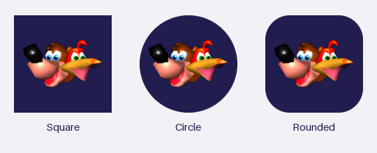

# Android launcher icon

The Android manifest did not declare an application icon, and Android resources
contained no launcher artwork. Android therefore had no project icon to use for
the home screen. This change wires the existing desktop Banjo/Kazooie artwork
into the Android application.



These are illustrative square, circular and rounded masks, not an Odin
screenshot. The launcher chooses its own mask and may add effects.

## Source and scope

- Base: `5db2d7f3719df6d196bf46a7a52a5e749d152956` on
  `fix/android-vulkan-transfer-proposal`.
- Existing source: `assets/icon.png`, 128 by 128 RGBA, unchanged.
  SHA-256: `23a51b3d02387dc7157eed4e820a428b51fb2d6e7c01b5d94e75b421ce6c5228`.
- The accepted TOOIE menu image is carried forward unchanged in both
  `assets/menu.png` and `android/app/src/main/assets/program/assets/menu.png`,
  together with its existing artwork note. Its SHA-256 remains
  `e7dc6ec776a14b09ca5108a9f279e7d0ac5e464d908e57a817a3534e7716bde6`.
- Only branding resources, the two manifest icon attributes, the generator and
  documentation change. Application ID, label, launcher activity, native code,
  build settings, saves and rendering diagnostics are unchanged.

## Android resources

- The application declares `@mipmap/ic_launcher` and
  `@mipmap/ic_launcher_round`.
- API 24/25 can use the committed 48/72/96/144/192 pixel legacy icons.
- API 26+ receives adaptive foreground/background layers. The foreground is a
  60 dp source square centered in a transparent 108 dp canvas; the background
  is deep purple `#211D4F`. Important visible pixels fit inside the central
  66 dp safe circle at all five densities. Android applies the outer mask.
- API 33+ also receives a monochrome layer using the foreground alpha, for
  launchers with themed icons enabled.
- The original 128 pixel artwork is resized, not redrawn. Upscaling does not
  add detail to that source.

The layout follows the official
[Android adaptive icon requirements](https://developer.android.com/develop/ui/compose/system/icon_design_adaptive).

## Regeneration

Normal APK builds consume the committed resources and need no new dependency.
To regenerate them, use Python with Pillow:

```sh
python3 tools/generate_android_launcher_icons.py
python3 tools/generate_android_launcher_icons.py --check
python3 tools/generate_android_launcher_icons.py --preview docs/android-launcher-icon-preview.png
```

`--check` compares decoded PNG pixels and XML, so PNG compression differences
alone do not cause a mismatch. Validation here used Pillow 12.3.0.

## Verification on 2026-10-17

- All 20 generated resources match the generator.
- Each foreground has the required density dimensions. Visible alpha of at
  least 16/255 has a maximum radius of 31.67 dp, within the 33 dp safe radius.
  Square, circle and rounded previews were inspected.
- Google AAPT2 `2.19-12782657` (AGP 8.9.2) compiled the actual resource directory
  and linked it against Android SDK Platform 36 revision 2. The fixture uses
  the application's existing package, minimum API 24 and target API 35. As
  Gradle does, the fixture supplies the package to the source manifest.
- The linked manifest resolves both icon resource IDs. The API 26 adaptive
  XML and API 33 monochrome XML resolve their foreground/background references.
- All 15 packaged PNGs preserve dimensions, alpha and every visible RGBA
  pixel. AAPT2 clears irrelevant RGB data under some fully transparent pixels.
- A manifest referring to a deliberately missing launcher icon fails the real
  AAPT2 linker, confirming the check detects missing resources.
- The menu copies retain the accepted artwork hash above. The manifest differs
  from the base only by the two icon attributes.

The AAPT2 input is produced with `aapt2 compile --dir
android/app/src/main/res -o resources.zip`. Link that archive as a positional
input with `aapt2 link -I /path/to/android.jar --manifest /path/to/merged-manifest.xml
--min-sdk-version 24 --target-sdk-version 35 -o icon-resources.ap_ resources.zip`.
`aapt2 dump badging` and `aapt2 dump xmltree --file AndroidManifest.xml` inspect
the resulting resource-only fixture.

This verifies Android resource packaging, not a complete gameplay APK or an
installed launcher. No device commands or installation were performed. The
home-screen icon will change when an APK containing these resources is built
and installed; this source change does not update an existing installation.
