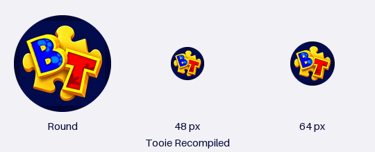

# Tooie Recompiled Android icon

The selected icon is the custom blue **B** and red **T**, slightly staggered
over a golden Jiggy. The user's final shape choice is **round**, and the visible
app name is exactly **Tooie Recompiled**.



## Source and scope

- This icon-only correction is based on integration commit
  `6a5a1e3250ca57f8797fc68e5567f9a5530e8351`, which includes the tested
  mod support and the player hierarchy implementation. Only the Android
  master, derived PNG resources, preview and this document change.
- `assets/android/launcher-master.png` is the exact selected generated artwork,
  1254 by 1254 pixels. SHA-256:
  `4b6db92f4ad3280c10131b5cec745508b19257a93ab1b2615279813ebca06784`.
  This is the exact reference supplied by the user on 18 October 2026,
  replacing the earlier, similar BT design. No characters or extra words
  are added to the icon.
- The source master retains its original navy background. Resource generation
  resizes and pads it without redrawing the letters or Jiggy.
- The application and launcher activity both use `@string/app_name`, defined
  once as `Tooie Recompiled`.
- Package identity remains `io.github.banjotooierecompiled`, preserving update
  identity and app data. Native code, activity class, build settings, saves,
  rendering diagnostics and the original desktop `assets/icon.png` are unchanged.
- The accepted TOOIE menu image remains unchanged in both existing menu paths.
  Its SHA-256 is
  `e7dc6ec776a14b09ca5108a9f279e7d0ac5e464d908e57a817a3534e7716bde6`.

## Android resources

- The application declares `@mipmap/ic_launcher` and
  `@mipmap/ic_launcher_round`. Both legacy resources have a circular alpha mask,
  matching the selected round design, at 48/72/96/144/192 pixels.
- API 26+ uses adaptive resources with a solid navy `#000536` background. The
  master occupies 63.36 dp of a 108 dp foreground canvas: 88% of the usual 72 dp
  mask viewport, matching the approved preview's padding.
- The colored Jiggy and letters fit within the central 66 dp safe circle.
  Dark navy corners of the square master may be clipped without losing artwork.
- The API 33 resources retain the colored icon. The opaque navy source is not
  reused as a monochrome alpha layer, which would produce a filled square.
- Adaptive outer shape is selected by Android's launcher. The round resources
  and circular preview express the preferred presentation; application resources
  cannot override a launcher's global icon mask.

See the official
[Android adaptive icon requirements](https://developer.android.com/develop/ui/compose/system/icon_design_adaptive).

## Regeneration and validation

Normal APK builds consume committed resources and need no new dependency.
Regeneration requires Python and Pillow:

```sh
python3 tools/generate_android_launcher_icons.py
python3 tools/generate_android_launcher_icons.py --check
python3 tools/generate_android_launcher_icons.py --preview docs/development/history/android-launcher-icon-preview.png
```

`--check` compares decoded PNG pixels and XML. PNG compression differences alone
do not cause a mismatch. Validation uses Pillow 12.3.0 and Google AAPT2
`2.19-12782657` against Android SDK Platform 36 revision 2:

- All 20 generated icon resources match the generator.
- Circular legacy PNGs have transparent corners and preserve the complete
  colored emblem. The selected master hash is unchanged.
- AAPT2 compiles the actual resource directory and links the actual manifest,
  with the application's package supplied as Gradle does, minimum API 24 and
  target API 35. Both application and launcher activity resolve to the exact
  label `Tooie Recompiled`.
- The linked manifest resolves both icon IDs, and adaptive foreground/background
  references resolve. Packaged PNGs preserve dimensions, alpha and visible pixels.
- A deliberately missing icon fails the actual linker; a separate wrong-name
  fixture is rejected by the resolved-label check.
- Both menu copies retain the accepted artwork hash above.

Compile with `aapt2 compile --dir android/app/src/main/res -o resources.zip`.
Link that archive as a positional input with `aapt2 link -I /path/to/android.jar
--manifest /path/to/merged-manifest.xml --min-sdk-version 24
--target-sdk-version 35 -o icon-resources.ap_ resources.zip`.
Inspect the result with `aapt2 dump badging` and `aapt2 dump xmltree --file
AndroidManifest.xml`.

These checks cover Android resources, not a complete gameplay APK or an
installed launcher. No device operation or installation was performed. The
icon and visible name change when an APK containing this branch is built and
installed.
